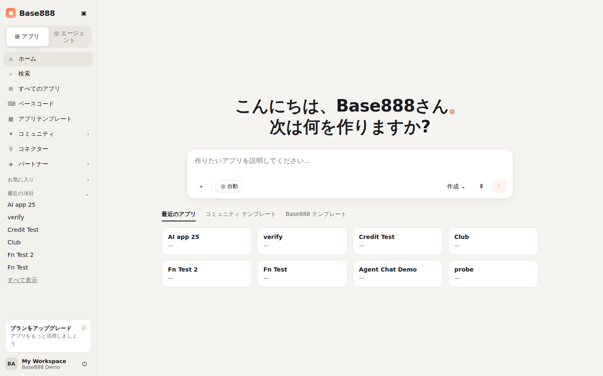
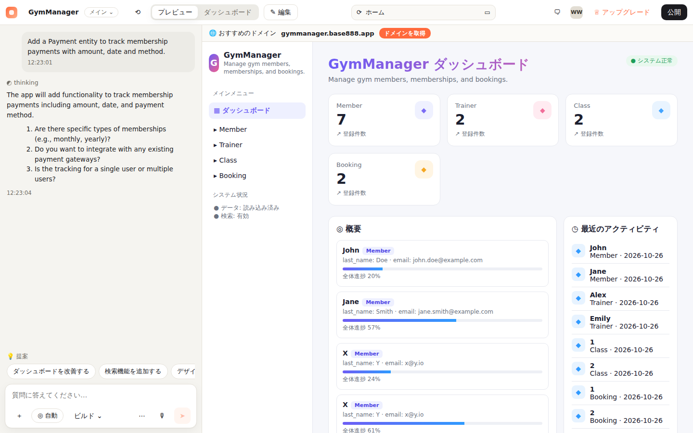
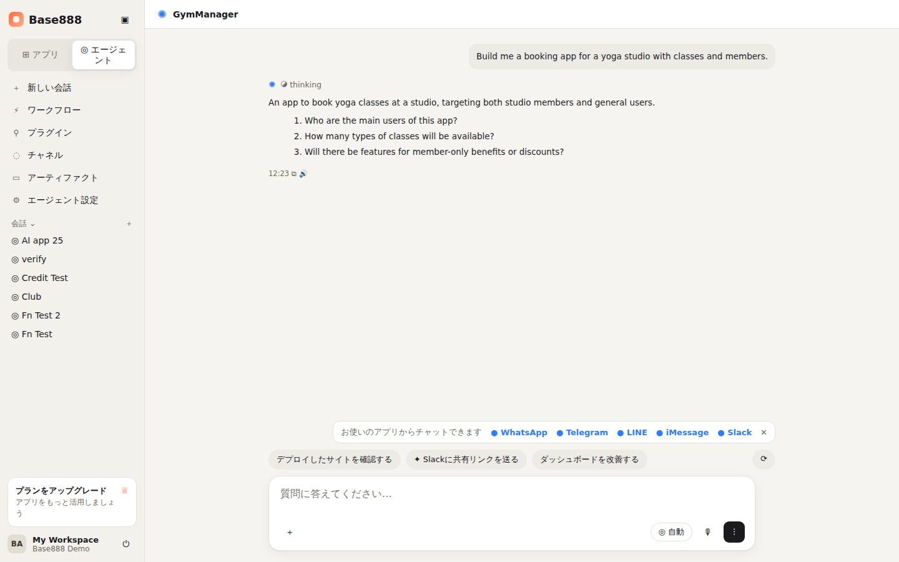
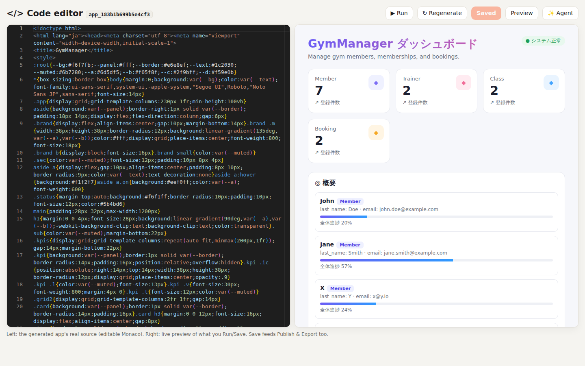
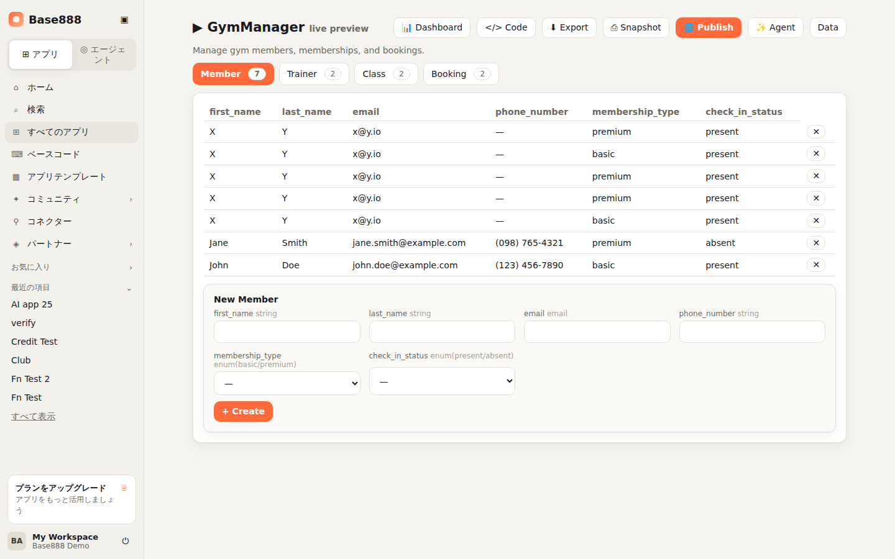
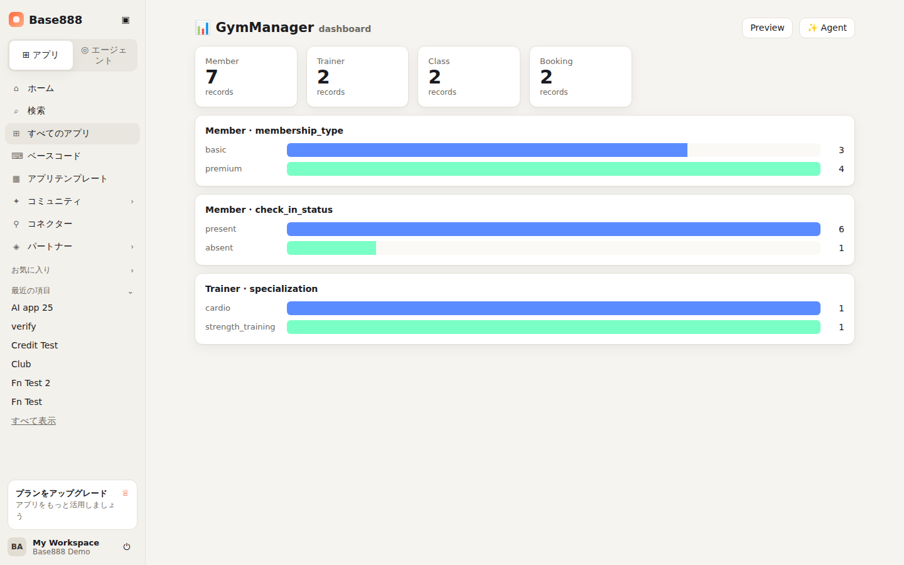
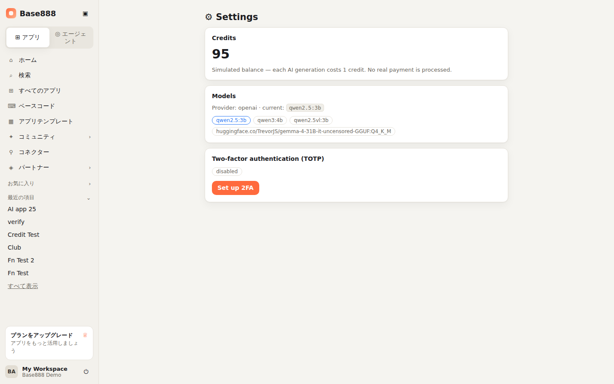
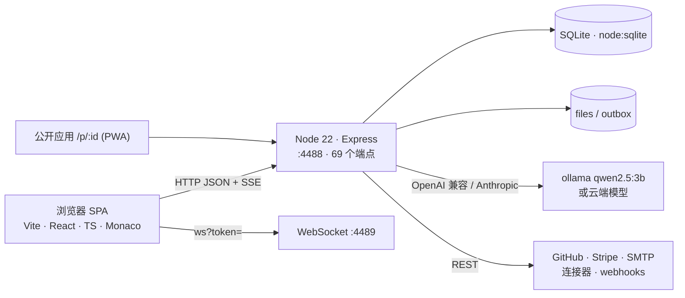
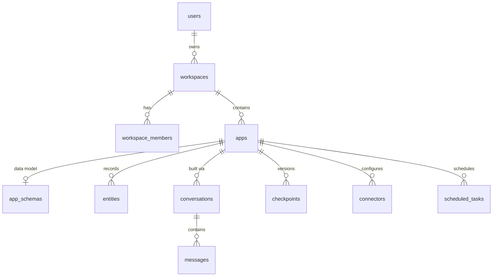

# Base888

**中文** · [English](README_EN.md) · [日本語](README_JA.md)

> Base888 是一个 **AI 应用构建器(vibe-coding 工具)** 的干净房间复刻:用自然语言描述需求,
> 智能体先提澄清问题、再设计数据模型和示例数据、生成可运行的单文件应用,
> 你可以在 Monaco 里改代码、实时预览、保存检查点(分支)、一键发布为公开 PWA、导出或推送到 GitHub。
> 它是用 [REA](https://github.com/morluto/rea) 对 Base44 **公开前端 bundle**(1466 个 chunk / 538 个组件)做逆向后,
> 以原创代码重建的——**不包含 Base44 的源码、资源或标识**,品牌为 Base888 自有。



---

## 目录

1. [项目定位与诚实声明](#1-项目定位与诚实声明)
2. [功能一览](#2-功能一览)
3. [界面画面](#3-界面画面)
4. [架构](#4-架构)
5. [快速开始](#5-快速开始)
6. [部署](#6-部署)
7. [需要哪些模型与服务](#7-需要哪些模型与服务)
8. [项目结构](#8-项目结构)
9. [数据模型(ER 图)](#9-数据模型er-图)
10. [API 概览](#10-api-概览)
11. [与 Base44 的对齐度](#11-与-base44-的对齐度)
12. [安全](#12-安全)
13. [开发与验证过程](#13-开发与验证过程)
14. [文档索引](#14-文档索引)
15. [许可与声明](#15-许可与声明)

---

## 1. 项目定位与诚实声明

- **做了什么**:复刻 Base44 式构建器的**核心循环**——首页提示词 → 智能体澄清 → 多实体数据模型 → 生成应用 → 实时预览 → Monaco 改代码 → 发布 / 导出 / 检查点 / GitHub。
- **UI/UX 对齐**:三个主视图(首页、编辑器/预览工作区、超级智能体对话)按真实构建器的布局重建,导航与文案取自逆向出的日文 locale。
- **诚实的覆盖率**:约 **35%**(经独立对抗式审计)。未实现的部分在 [`base888/PARITY-LEDGER.md`](base888/PARITY-LEDGER.md) 逐条标注,**不虚标**。
- **不是什么**:不是 Base44 的克隆源码;不含云部署/自定义域名开通、原生 App 编译、几十个品牌 OAuth 连接器市场、多文件 React 工程在线编辑;消息渠道(WhatsApp/Telegram/LINE/iMessage/Slack)仅展示、未接通并在界面明示。
- **生成质量取决于模型**:默认本地 `qwen2.5:3b`(免费、质量一般);配置 Anthropic / OpenAI 兼容 key 即可获得前沿质量,无需改代码。

## 2. 功能一览

| 领域 | 功能 |
|------|------|
| 账户与安全 | 注册 / 登录(scrypt 哈希)、HS256 JWT、**一次性轮换刷新令牌**、**TOTP 两步验证**、登录限流、安全响应头、CORS 白名单 |
| 工作区与应用 | 工作区与成员鉴权(越权 → 403)、应用 CRUD、最近项目、搜索、模板一键建站 |
| **智能体构建** | 流式(SSE)对话:澄清问题 → 规划 → 逐实体构建 → 完成;4–7 个实体,含枚举、引用关系、示例数据 |
| 数据层 | 服务端 **类型 / 必填 / 枚举 / 引用完整性校验**;富查询(`$gt $lt $ne $in $contains`、排序、分页);手动 schema 编辑接口 |
| 生成应用 | 仪表盘风格**单文件可运行应用**(侧导航、KPI、活动流、可搜索表格);**Monaco** 在线编辑真实源码;实时预览 |
| 发布与导出 | 发布为公开只读页 `/p/:id`(**可安装 PWA**);导出 HTML;**GitHub 导出**(用你的 PAT 真建仓库并提交);**检查点 = 分支**(快照 / 回滚) |
| 分析 | 每应用仪表盘:实体 KPI 卡片 + 枚举分布柱状图(实时数据计算) |
| 集成 | `InvokeLLM`、`CompareModels`、`SendEmail`(SMTP 或真实 `.eml`)、`UploadFile`(落盘并可访问)、`GenerateImage`(需 key) |
| 扩展 | 函数(注册 handler URL 并转发)、**连接器**(目录 + 真实 HTTP / webhook / REST 调用)、**工作流**(进程内定时调度器真实触发) |
| 计费 | 模拟积分(每次生成 -1,耗尽 402);Stripe Checkout(配置 key 后真实结账) |
| 其他 | 模型列表、社区(已公开应用)、工件页、设置页、日文 UI 文案、i18n |

## 3. 界面画面

详见 [`docs/UI-SCREENS.md`](docs/UI-SCREENS.md)(含全部 15 张截图与逐项功能说明)。

| 首页 — 问候 + 提示词输入 + 侧栏 | 编辑器 / 预览工作区 — 左对话、右实时预览 |
|---|---|
|  |  |

| 超级智能体对话 — 渠道栏与动作 chips | Monaco 代码编辑器 — 真实源码 + 实时预览 |
|---|---|
|  |  |

| Schema 驱动预览(类型化表单、枚举、引用选择) | 仪表盘 | 设置(积分 / 模型 / 2FA) |
|---|---|---|
|  |  |  |

## 4. 架构



| 层 | 技术 |
|----|------|
| 前端 | Vite 5、React 18、TypeScript、React Router、zustand、axios、i18next、`@monaco-editor/react` |
| 后端 | Node 22(`node:sqlite`)、Express 4、`ws`、undici、nodemailer、busboy |
| 智能体 | `agent.js`(澄清 → 构建 → 物化,SSE 事件流)、`llm.js`(JSON 模式、temperature 0、长超时) |
| 生成 | `codegen.js`(仪表盘风格单文件应用)、`schema.js`(校验 + 查询引擎) |

详见 [`docs/ARCHITECTURE.md`](docs/ARCHITECTURE.md)(含请求管线、智能体时序图、模块职责)。

## 5. 快速开始

```bash
# 前提:Node ≥ 22.5、pnpm、本地 ollama(或云端 key)
git clone https://github.com/Victory963/Base888.git && cd Base888/base888
pnpm -C web install && pnpm -C server install
ollama pull qwen2.5:3b                       # 默认本地模型(约 1.9 GB)

# 终端 1:API
cd server && LLM_PROVIDER=openai LLM_BASE_URL=http://localhost:11434/v1 LLM_API_KEY=ollama LLM_MODEL=qwen2.5:3b node --no-warnings index.js
# 终端 2:Web
cd ../web && pnpm dev                         # http://localhost:5888
```

登录 `demo@base888.local` / `demo`(首次启动自动种子)。在首页输入"一个管理健身房会员和课程预约的应用",回答澄清问题,即可看到构建与预览。

想要前沿质量:`ANTHROPIC_API_KEY=sk-ant-... node --no-warnings index.js`(或 `OPENAI_API_KEY`)。

## 6. 部署

- `pnpm -C web build` 产出静态站点 `web/dist`;API 以 `node --no-warnings index.js` 常驻(systemd / pm2)。
- 反向代理把 `/api /auth /apps /workspaces /p /files` 转发到 `:4488`,**关闭响应缓冲以支持 SSE**;SPA 回退到 `index.html`。
- 持久化目录 `server/data`(SQLite、上传、outbox、JWT 密钥)需挂载与备份。
- 提供 Caddy / nginx / systemd / Dockerfile 示例。

完整步骤、环境变量表与排错:[`docs/DEPLOYMENT.md`](docs/DEPLOYMENT.md)。

## 7. 需要哪些模型与服务

| 用途 | 选项 | 说明 |
|------|------|------|
| **LLM(必需)** | 本地 ollama `qwen2.5:3b`(默认) | 免费;GPU 上一次构建约 20–60 秒,CPU 上数分钟 |
| | Anthropic(`ANTHROPIC_API_KEY`)/ OpenAI 及任意 OpenAI 兼容端点(`OPENAI_API_KEY` 或 `LLM_*`) | 秒级、高质量;要求支持 JSON 模式输出 |
| 图像生成 | OpenAI Images(`IMAGE_API_KEY`) | 未配置 → 真实 `503` |
| 邮件 | 任意 SMTP(`SMTP_URL`) | 未配置 → 写真实 `.eml` 到 outbox |
| 支付 | Stripe(`STRIPE_SECRET_KEY`) | 未配置 → `503` |
| GitHub 导出 | 用户自带 PAT(`repo` 权限) | 请求时提供 |
| 防机器人 | Cloudflare Turnstile | 可选 |

详见 [`docs/MODELS.md`](docs/MODELS.md)。

## 8. 项目结构

```
Base888/
├── README.md · README_EN.md · README_JA.md
├── base888/
│   ├── web/            Vite + React + TS 前端(src/pages 视图、components/AppShell 侧栏壳、hooks/useAgentChat 等)
│   ├── server/         Node/Express 后端(index.js 69 个端点;src/ agent·schema·codegen·llm·auth·totp·github·mailer·ws·db)
│   ├── PARITY-LEDGER.md · SECURITY-FINDINGS.md · SECURITY-CHECKUP.md
├── docs/               ARCHITECTURE · ER-DIAGRAM · TREE · UI-SCREENS · DEPLOYMENT · MODELS · API · screenshots/
├── analysis/           逆向工程报告与提取的端点 / 路由清单
└── work/base888/       reverse-skill 案例:scope、timeline、证据记录
```

带注释的完整树:[`docs/TREE.md`](docs/TREE.md)。

## 9. 数据模型(ER 图)

17 张 SQLite 表:`users · workspaces · workspace_members · invites · refresh_tokens · apps · app_schemas · entities · conversations · messages · checkpoints · app_functions · connectors · scheduled_tasks · files · feature_flags · consent_receipts`。



完整字段级 ER 图与表说明:[`docs/ER-DIAGRAM.md`](docs/ER-DIAGRAM.md)。

## 10. API 概览

69 个端点,按认证 / 系统 / 工作区与应用 / 数据模型与记录 / 智能体(SSE)/ 代码·版本·发布 / 集成·函数·连接器·任务 分组;应用级路由全部校验工作区成员身份。SDK 形态:`client.auth / entities.<Name> / integrations.core / functions`。

完整参考:[`docs/API.md`](docs/API.md)。

## 11. 与 Base44 的对齐度

| 已对齐(真实实现) | 未对齐(明确标注) |
|---|---|
| 首页 / 编辑器预览 / 超级智能体三视图 UI;澄清式智能体;多实体模型;服务端校验与富查询;Monaco 改码;实时预览;发布(PWA);导出;GitHub 导出;检查点分支;仪表盘;TOTP;连接器;工作流;积分;Stripe(有 key) | 真实云部署与自定义域名;原生 iOS/Android 编译;几十个品牌 OAuth 连接器市场;多文件 React 工程 + 专有运行时的在线编辑;无 key 时的前沿模型质量;OAuth 登录;消息渠道接通 |

逐条账本(含两轮独立对抗式审计的结论与修正):[`base888/PARITY-LEDGER.md`](base888/PARITY-LEDGER.md)。

## 12. 安全

已验证:越权(IDOR)→ 403、JWT 篡改 → 401、刷新令牌一次性、参数化 SQL(无注入)、CORS 白名单、scrypt 密码、登录限流、安全响应头。开放项与建议(文件按 id 无鉴权、密码强度策略、内存态限流、函数 handler 的 SSRF 白名单)见 [`base888/SECURITY-FINDINGS.md`](base888/SECURITY-FINDINGS.md);自动化渗透(PentAGI)runbook 见 [`base888/SECURITY-CHECKUP.md`](base888/SECURITY-CHECKUP.md)。**安全测试只针对你自己的 Base888 部署。**

## 13. 开发与验证过程

1. 用 REA(`analyze_javascript_application`)对 Base44 公开前端做静态分析,抓取完整 bundle(1466 chunks / 538 组件名),提取技术栈、后端拓扑、接口形态、日文 locale 文案 → [`analysis/REVERSE-ENGINEERING-REPORT.md`](analysis/REVERSE-ENGINEERING-REPORT.md)。
2. 以原创代码重建:先核心循环,再数据层真实化、版本 / 发布 / 导出、2FA / 模型 / 积分,再代码编辑器 / GitHub / 连接器 / Stripe / PWA,最后按真实构建器重做 UI。
3. **三轮独立对抗式 Agent 审计**:找出并修正了过度表述(如"AI coding"措辞)、过期文档、死路由(函数注册)、数据层未强制等问题;逐项验证新功能为真。
4. 全程遵守 [reverse-skill](https://github.com/zhaoxuya520/reverse-skill) 的授权范围契约(`work/base888/scope.md`)。

## 14. 文档索引

| 文档 | 内容 |
|------|------|
| [docs/ARCHITECTURE.md](docs/ARCHITECTURE.md) | 系统架构、前后端模块、请求管线、智能体时序 |
| [docs/ER-DIAGRAM.md](docs/ER-DIAGRAM.md) | 字段级 ER 图与表说明 |
| [docs/TREE.md](docs/TREE.md) | 带注释的项目树 |
| [docs/UI-SCREENS.md](docs/UI-SCREENS.md) | 全部界面截图与功能说明 |
| [docs/DEPLOYMENT.md](docs/DEPLOYMENT.md) | 安装、环境变量、生产部署、Docker、备份、排错 |
| [docs/MODELS.md](docs/MODELS.md) | 模型与外部服务选型 |
| [docs/API.md](docs/API.md) | 69 个端点参考 |
| [base888/PARITY-LEDGER.md](base888/PARITY-LEDGER.md) | 与 Base44 的诚实对齐账本 |
| [base888/SECURITY-FINDINGS.md](base888/SECURITY-FINDINGS.md) | 安全体检结论 |
| [analysis/REVERSE-ENGINEERING-REPORT.md](analysis/REVERSE-ENGINEERING-REPORT.md) | 逆向工程报告 |

## 15. 许可与声明

- 代码:**MIT**(见 [LICENSE](LICENSE))。
- "Base44" 为其所有者的商标。Base888 是独立的研究 / 教育性质的干净房间复刻,与 Base44 **无关联、未获背书**,不包含其源码、资源、标识;仓库中不包含任何抓取到的第三方 bundle。
- 分析仅基于公开下发到浏览器的客户端代码;安全测试仅针对自有部署。
