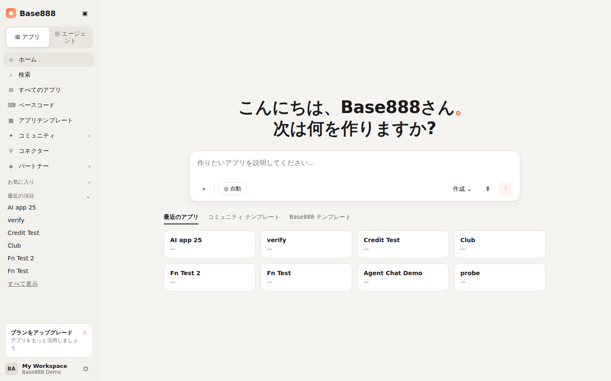
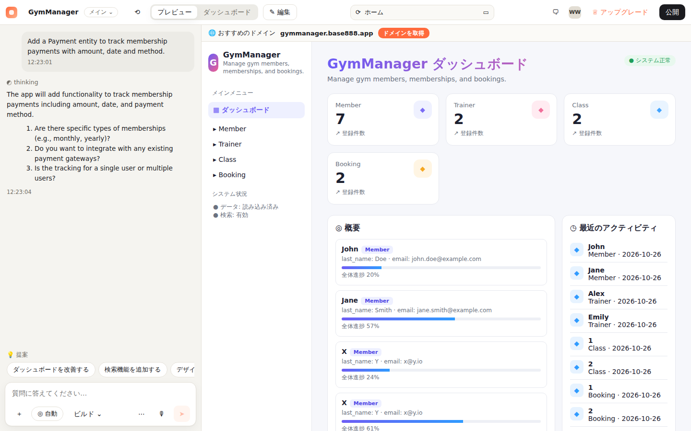
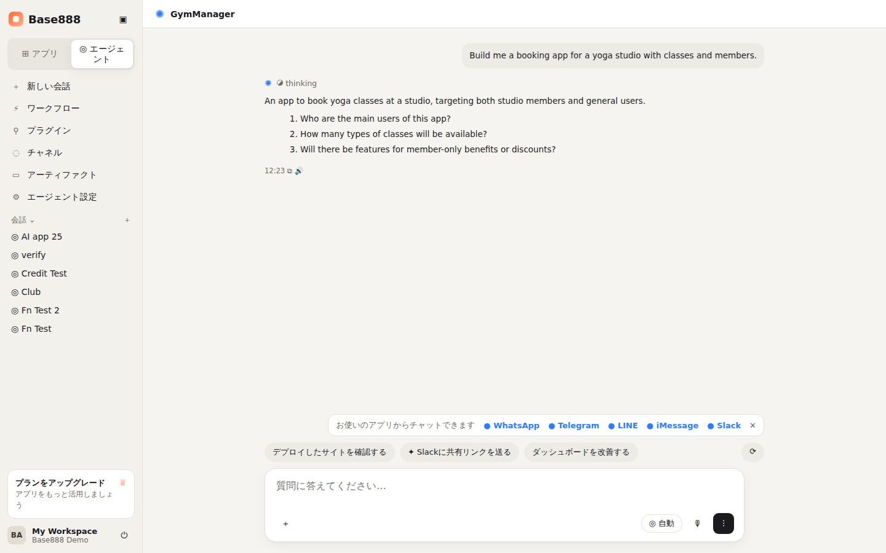
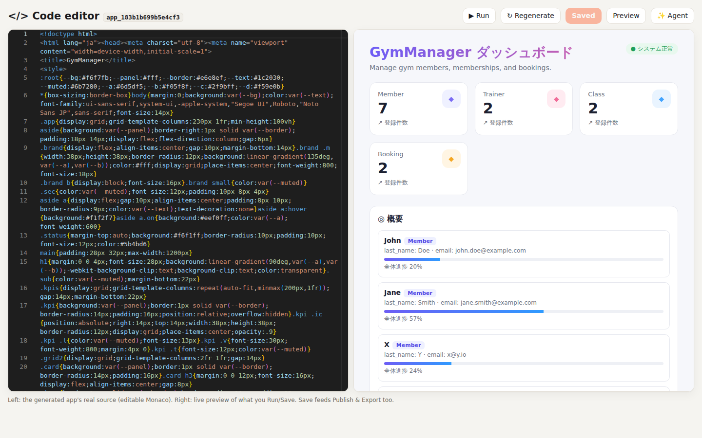
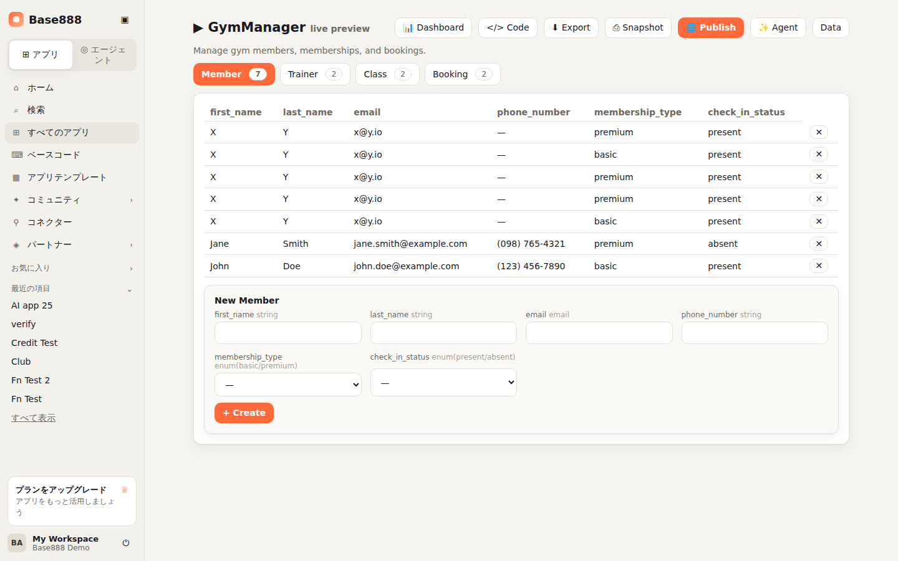
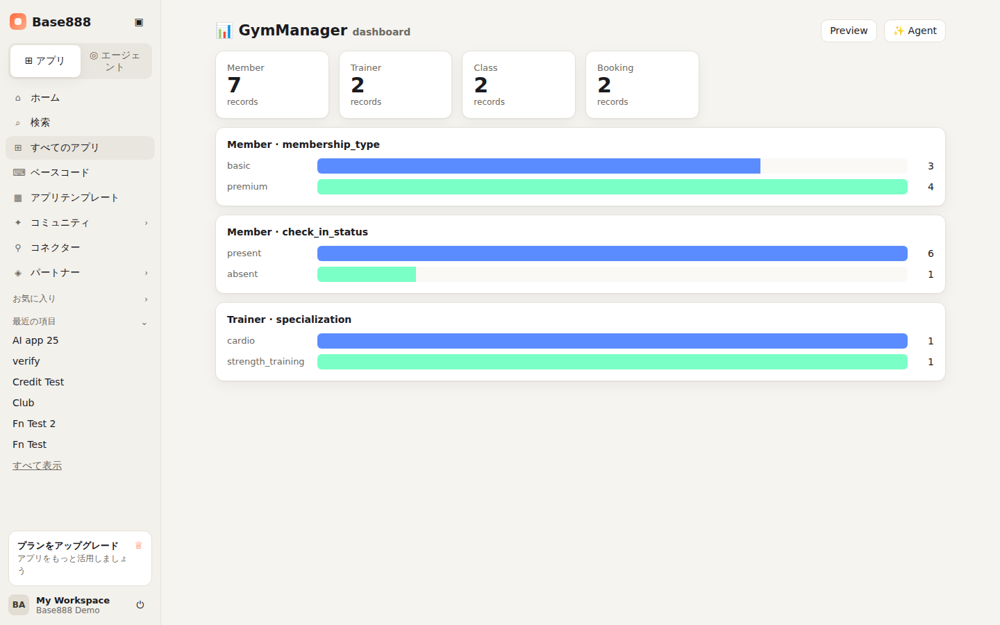
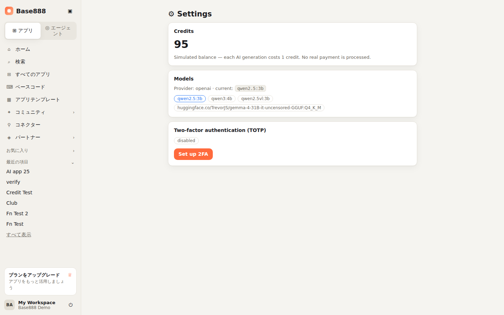
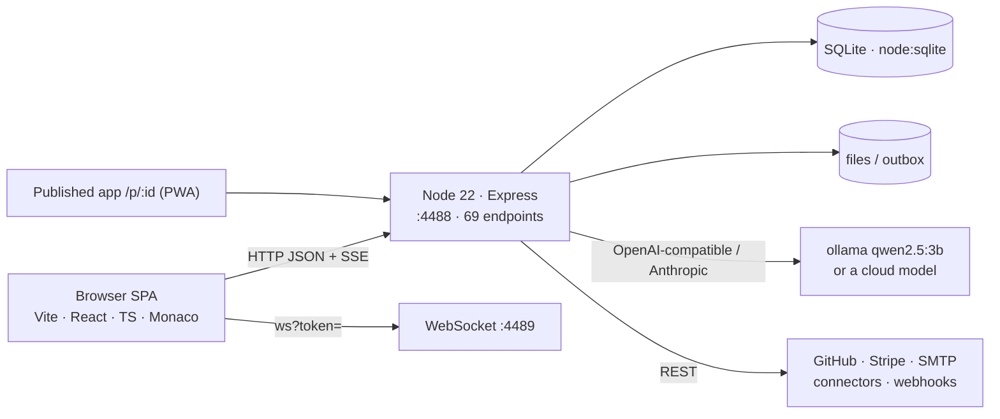
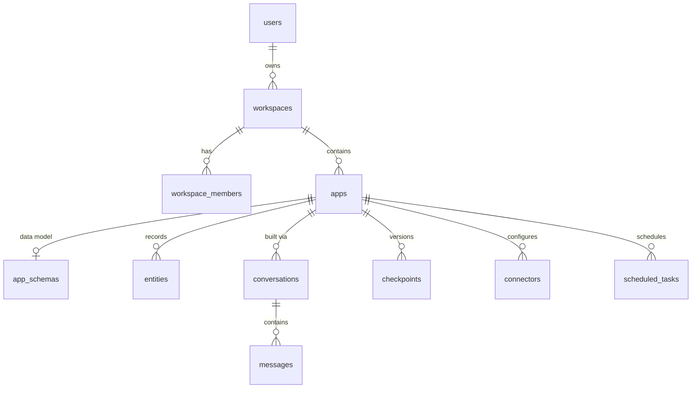

# Base888

[中文](README.md) · **English** · [日本語](README_JA.md)

> Base888 is a clean-room reconstruction of an **AI app builder (a vibe-coding tool)**: describe what
> you want in plain language; an agent asks clarifying questions, designs a data model with sample
> data, and generates a runnable single-file app that you can edit in Monaco, preview live,
> checkpoint (branches), publish as an installable PWA, export, or push to GitHub.
> It was built by reverse-engineering Base44's **publicly served frontend bundle** (1,466 chunks /
> 538 components) with [REA](https://github.com/morluto/rea), then rebuilt as original code —
> **no Base44 source, assets, or logo are included**; the brand is Base888's own.



---

## Contents

1. [Positioning & honesty statement](#1-positioning--honesty-statement)
2. [Features](#2-features)
3. [Screens](#3-screens)
4. [Architecture](#4-architecture)
5. [Quick start](#5-quick-start)
6. [Deployment](#6-deployment)
7. [Models & services required](#7-models--services-required)
8. [Project structure](#8-project-structure)
9. [Data model (ER diagram)](#9-data-model-er-diagram)
10. [API overview](#10-api-overview)
11. [Parity with Base44](#11-parity-with-base44)
12. [Security](#12-security)
13. [How it was built and verified](#13-how-it-was-built-and-verified)
14. [Documentation index](#14-documentation-index)
15. [License & disclaimer](#15-license--disclaimer)

---

## 1. Positioning & honesty statement

- **What it does**: reproduces the builder's **core loop** — home prompt → agent clarification →
  multi-entity data model → generated app → live preview → Monaco code editing → publish / export /
  checkpoints / GitHub.
- **UI/UX alignment**: the three main views (Home, Editor/Preview workspace, Superagent chat) follow
  the real builder's layout; navigation labels come from the reverse-engineered Japanese locale.
- **Honest coverage**: roughly **35%**, confirmed by independent adversarial audits. Everything not
  implemented is itemized in [`base888/PARITY-LEDGER.md`](base888/PARITY-LEDGER.md) — nothing is overstated.
- **What it is not**: not a clone of Base44's source; no cloud deploy / custom-domain provisioning,
  no native app compilation, no marketplace of dozens of branded OAuth connectors, no multi-file React
  project editing; messaging channels (WhatsApp/Telegram/LINE/iMessage/Slack) are displayed but not
  connected, and the UI says so.
- **Generation quality follows the model**: the default is a local `qwen2.5:3b` (free, modest quality);
  set an Anthropic / OpenAI-compatible key for frontier quality — no code changes needed.

## 2. Features

| Area | Capabilities |
|------|--------------|
| Accounts & security | registration / login (scrypt), HS256 JWT, **single-use rotating refresh tokens**, **TOTP 2FA**, login rate limiting, security headers, CORS allow-list |
| Workspaces & apps | workspace membership authorization (IDOR → 403), app CRUD, recent items, search, one-click templates |
| **Agent builder** | streaming (SSE) conversation: clarifying questions → plan → build per entity → done; 4–7 entities with enums, references and sample rows |
| Data layer | server-side **type / required / enum / reference-integrity validation**; rich queries (`$gt $lt $ne $in $contains`, sort, pagination); manual schema editing API |
| Generated app | dashboard-style **runnable single-file app** (side nav, KPIs, activity feed, searchable tables); **Monaco** editing of the real source; live preview |
| Publish & export | publish as a public read-only page `/p/:id` (**installable PWA**); HTML export; **GitHub export** (really creates a repo and commits with your PAT); **checkpoints = branches** (snapshot / restore) |
| Analytics | per-app dashboard: entity KPI cards + enum breakdown bar charts from live data |
| Integrations | `InvokeLLM`, `CompareModels`, `SendEmail` (SMTP or a real `.eml`), `UploadFile` (stored and served), `GenerateImage` (needs a key) |
| Extensibility | functions (register a handler URL, forwarded), **connectors** (catalog + real HTTP / webhook / REST calls), **workflows** (in-process scheduler that really fires) |
| Billing | simulated credits (−1 per generation, 402 when exhausted); Stripe Checkout (real with a key) |
| Misc | model listing, community (published apps), artifacts page, settings, Japanese UI copy, i18n |

## 3. Screens

See [`docs/UI-SCREENS.md`](docs/UI-SCREENS.md) for all 15 screenshots with feature-by-feature notes.

| Home — greeting + prompt composer + sidebar | Editor / Preview — chat left, live preview right |
|---|---|
|  |  |

| Superagent — channel bar & action chips | Monaco code editor — real source + live preview |
|---|---|
|  |  |

| Schema-driven preview (typed forms, enums, references) | Dashboard | Settings (credits / models / 2FA) |
|---|---|---|
|  |  |  |

## 4. Architecture



| Layer | Technology |
|-------|------------|
| Frontend | Vite 5, React 18, TypeScript, React Router, zustand, axios, i18next, `@monaco-editor/react` |
| Backend | Node 22 (`node:sqlite`), Express 4, `ws`, undici, nodemailer, busboy |
| Agent | `agent.js` (clarify → build → materialize, SSE events), `llm.js` (JSON mode, temperature 0, long timeouts) |
| Generation | `codegen.js` (dashboard-style single-file app), `schema.js` (validation + query engine) |

Details in [`docs/ARCHITECTURE.md`](docs/ARCHITECTURE.md) (request pipeline, agent sequence diagram, module responsibilities).

## 5. Quick start

```bash
# prerequisites: Node ≥ 22.5, pnpm, local ollama (or a cloud key)
git clone https://github.com/Victory963/Base888.git && cd Base888/base888
pnpm -C web install && pnpm -C server install
ollama pull qwen2.5:3b                       # default local model (~1.9 GB)

# terminal 1: API
cd server && LLM_PROVIDER=openai LLM_BASE_URL=http://localhost:11434/v1 LLM_API_KEY=ollama LLM_MODEL=qwen2.5:3b node --no-warnings index.js
# terminal 2: web
cd ../web && pnpm dev                         # http://localhost:5888
```

Sign in with `demo@base888.local` / `demo` (seeded on first boot). On the home screen type
"an app to manage gym members and class bookings", answer the clarifying questions, and watch
the build and the preview.

For frontier quality: `ANTHROPIC_API_KEY=sk-ant-... node --no-warnings index.js` (or `OPENAI_API_KEY`).

## 6. Deployment

- `pnpm -C web build` produces the static site in `web/dist`; run the API with `node --no-warnings index.js` under systemd / pm2.
- Reverse-proxy `/api /auth /apps /workspaces /p /files` to `:4488` with **response buffering disabled (SSE)**; fall back the SPA to `index.html`.
- Mount and back up the persistent `server/data` directory (SQLite, uploads, outbox, JWT secret).
- Caddy / nginx / systemd / Dockerfile examples are provided.

Full steps, the environment-variable table and troubleshooting: [`docs/DEPLOYMENT.md`](docs/DEPLOYMENT.md).

## 7. Models & services required

| Purpose | Options | Notes |
|---------|---------|-------|
| **LLM (required)** | local ollama `qwen2.5:3b` (default) | free; ~20–60 s per build on a GPU, minutes on CPU |
| | Anthropic (`ANTHROPIC_API_KEY`) / OpenAI or any OpenAI-compatible endpoint (`OPENAI_API_KEY` or `LLM_*`) | seconds, high quality; must support JSON-mode output |
| Image generation | OpenAI Images (`IMAGE_API_KEY`) | unset → honest `503` |
| Email | any SMTP (`SMTP_URL`) | unset → a real `.eml` is written to the outbox |
| Payments | Stripe (`STRIPE_SECRET_KEY`) | unset → `503` |
| GitHub export | your own PAT (`repo` scope) | supplied per request |
| Bot protection | Cloudflare Turnstile | optional |

Details in [`docs/MODELS.md`](docs/MODELS.md).

## 8. Project structure

```
Base888/
├── README.md · README_EN.md · README_JA.md
├── base888/
│   ├── web/            Vite + React + TS frontend (src/pages views, components/AppShell sidebar shell, hooks/useAgentChat, …)
│   ├── server/         Node/Express backend (index.js — 69 endpoints; src/ agent·schema·codegen·llm·auth·totp·github·mailer·ws·db)
│   ├── PARITY-LEDGER.md · SECURITY-FINDINGS.md · SECURITY-CHECKUP.md
├── docs/               ARCHITECTURE · ER-DIAGRAM · TREE · UI-SCREENS · DEPLOYMENT · MODELS · API · screenshots/
├── analysis/           reverse-engineering report and extracted endpoint / route lists
└── work/base888/       reverse-skill case: scope, timeline, evidence notes
```

Annotated full tree: [`docs/TREE.md`](docs/TREE.md).

## 9. Data model (ER diagram)

17 SQLite tables: `users · workspaces · workspace_members · invites · refresh_tokens · apps · app_schemas · entities · conversations · messages · checkpoints · app_functions · connectors · scheduled_tasks · files · feature_flags · consent_receipts`.



Field-level ER diagram and table notes: [`docs/ER-DIAGRAM.md`](docs/ER-DIAGRAM.md).

## 10. API overview

69 endpoints grouped into auth / system / workspaces & apps / data model & records / agent (SSE) /
code · versions · publish / integrations · functions · connectors · tasks; every app-scoped route
checks workspace membership. SDK shape: `client.auth / entities.<Name> / integrations.core / functions`.

Full reference: [`docs/API.md`](docs/API.md).

## 11. Parity with Base44

| Aligned (real implementations) | Not aligned (explicitly marked) |
|---|---|
| Home / Editor-Preview / Superagent UI; clarify-first agent; multi-entity model; server-side validation + rich queries; Monaco editing; live preview; publish (PWA); export; GitHub export; checkpoint branches; dashboard; TOTP; connectors; workflows; credits; Stripe (with key) | real cloud deploy + custom domains; native iOS/Android builds; marketplace of dozens of branded OAuth connectors; multi-file React project + proprietary runtime editing; frontier quality without a key; OAuth sign-in; connected messaging channels |

Itemized ledger, including the findings and fixes from two independent adversarial audits:
[`base888/PARITY-LEDGER.md`](base888/PARITY-LEDGER.md).

## 12. Security

Verified: IDOR → 403, JWT tampering → 401, single-use refresh tokens, parameterized SQL (no injection),
CORS allow-list, scrypt passwords, login rate limiting, security headers. Open items and recommendations
(files served by id without authz, password policy, in-memory rate store, SSRF allow-list for function
handlers) are in [`base888/SECURITY-FINDINGS.md`](base888/SECURITY-FINDINGS.md); the automated-pentest
(PentAGI) runbook is in [`base888/SECURITY-CHECKUP.md`](base888/SECURITY-CHECKUP.md).
**Security testing targets only your own Base888 deployment.**

## 13. How it was built and verified

1. Static analysis of Base44's public frontend with REA (`analyze_javascript_application`), capturing the
   full bundle (1,466 chunks / 538 component names) and extracting the stack, backend topology, API
   shapes and Japanese locale strings → [`analysis/REVERSE-ENGINEERING-REPORT.md`](analysis/REVERSE-ENGINEERING-REPORT.md).
2. Rebuilt as original code: the core loop first, then a real data layer, versions / publish / export,
   2FA / models / credits, then the code editor / GitHub / connectors / Stripe / PWA, and finally the UI
   re-done to match the real builder.
3. **Three rounds of independent adversarial-agent audits** found and fixed overstatements (e.g. "AI coding"
   wording), stale docs, a dead route (function registration) and an unenforced data layer; each new feature
   was verified real.
4. All work followed the [reverse-skill](https://github.com/zhaoxuya520/reverse-skill) scope contract
   (`work/base888/scope.md`).

## 14. Documentation index

| Document | Contents |
|----------|----------|
| [docs/ARCHITECTURE.md](docs/ARCHITECTURE.md) | system architecture, front/back-end modules, request pipeline, agent sequence |
| [docs/ER-DIAGRAM.md](docs/ER-DIAGRAM.md) | field-level ER diagram and table notes |
| [docs/TREE.md](docs/TREE.md) | annotated project tree |
| [docs/UI-SCREENS.md](docs/UI-SCREENS.md) | every screen with screenshots and feature notes |
| [docs/DEPLOYMENT.md](docs/DEPLOYMENT.md) | install, env vars, production, Docker, backup, troubleshooting |
| [docs/MODELS.md](docs/MODELS.md) | model and external-service choices |
| [docs/API.md](docs/API.md) | reference for all 69 endpoints |
| [base888/PARITY-LEDGER.md](base888/PARITY-LEDGER.md) | honest parity ledger vs Base44 |
| [base888/SECURITY-FINDINGS.md](base888/SECURITY-FINDINGS.md) | security checkup findings |
| [analysis/REVERSE-ENGINEERING-REPORT.md](analysis/REVERSE-ENGINEERING-REPORT.md) | reverse-engineering report |

## 15. License & disclaimer

- Code: **MIT** (see [LICENSE](LICENSE)).
- "Base44" is a trademark of its owner. Base888 is an independent research/educational clean-room
  reconstruction, **not affiliated with or endorsed by** Base44, and contains none of its source code,
  assets or logo; no captured third-party bundle is included in this repository.
- Analysis was limited to client code publicly served to browsers; security testing targets only
  self-hosted deployments.
