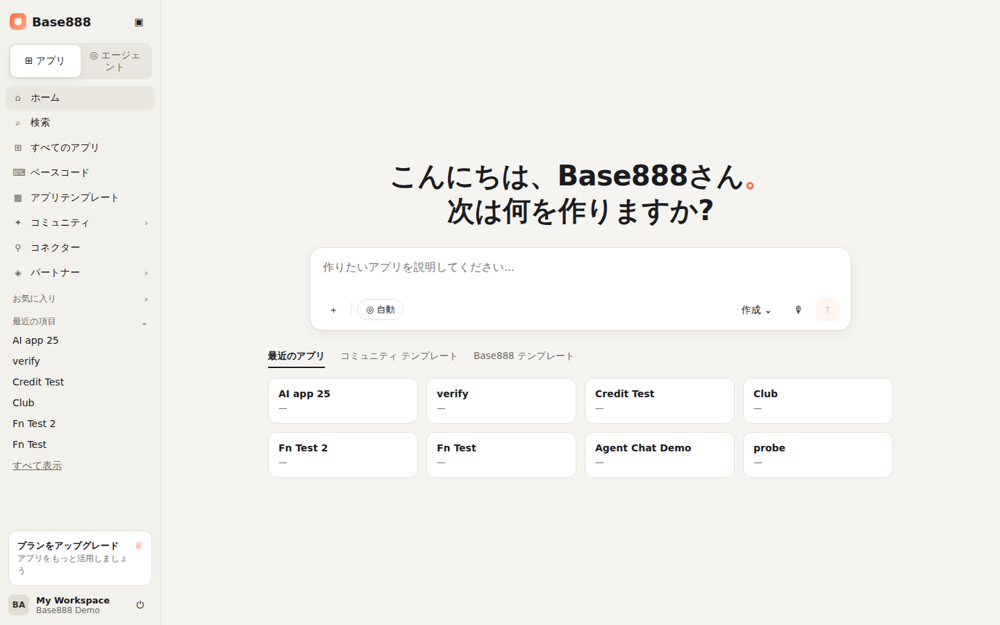
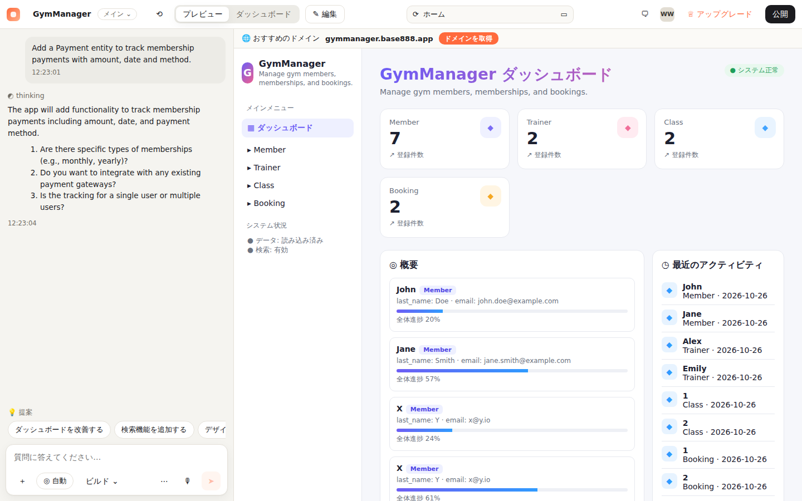
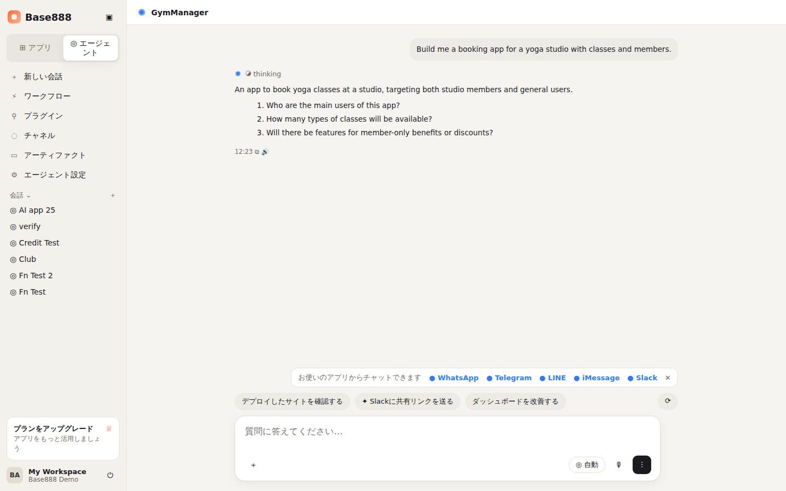
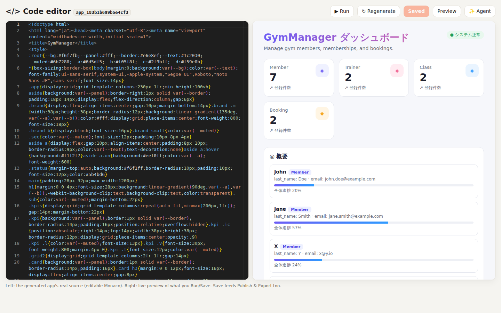
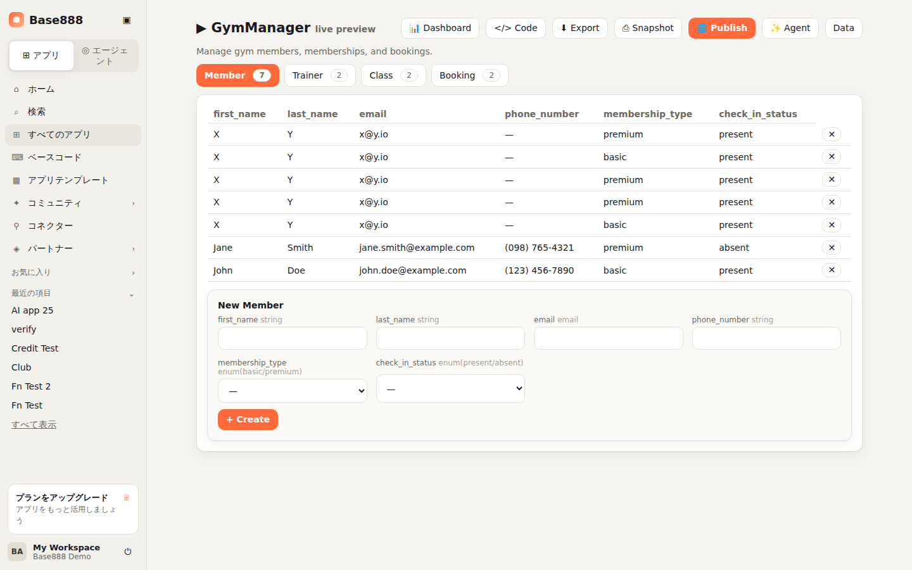
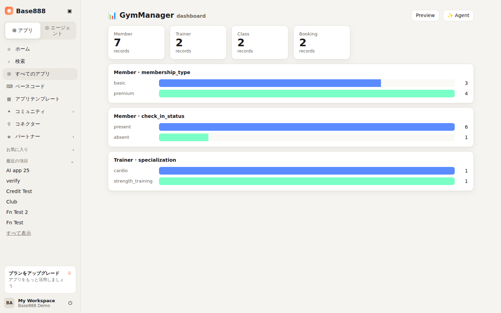
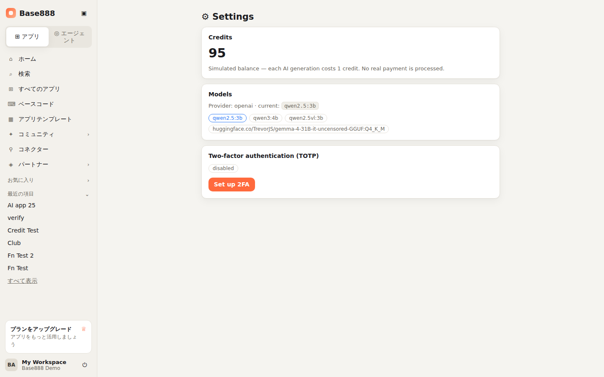
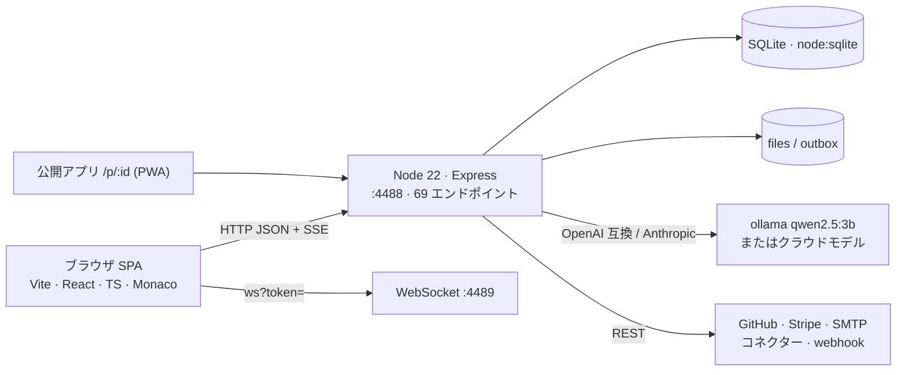
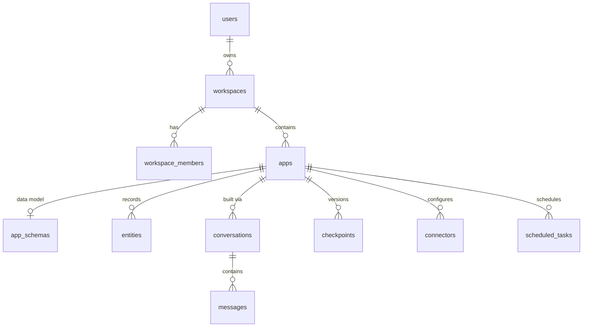

# Base888

[中文](README.md) · [English](README_EN.md) · **日本語**

> Base888 は **AI アプリビルダー(vibe-coding ツール)** のクリーンルーム再構築です。自然言語で要望を書くと、
> エージェントが先に確認質問を行い、データモデルとサンプルデータを設計し、実行可能な単一ファイルの
> アプリを生成します。生成コードは Monaco で編集でき、ライブプレビュー、チェックポイント(ブランチ)、
> インストール可能な PWA としての公開、エクスポート、GitHub へのプッシュに対応します。
> Base44 の **公開配信されているフロントエンド bundle**(1,466 チャンク / 538 コンポーネント)を
> [REA](https://github.com/morluto/rea) で解析し、オリジナルのコードで再構築したもので、
> **Base44 のソースコード・アセット・ロゴは一切含みません**。ブランドは Base888 独自です。



---

## 目次

1. [位置づけと誠実な表明](#1-位置づけと誠実な表明)
2. [機能一覧](#2-機能一覧)
3. [画面](#3-画面)
4. [アーキテクチャ](#4-アーキテクチャ)
5. [クイックスタート](#5-クイックスタート)
6. [デプロイ](#6-デプロイ)
7. [必要なモデルとサービス](#7-必要なモデルとサービス)
8. [プロジェクト構成](#8-プロジェクト構成)
9. [データモデル(ER 図)](#9-データモデルer-図)
10. [API 概要](#10-api-概要)
11. [Base44 との整合度](#11-base44-との整合度)
12. [セキュリティ](#12-セキュリティ)
13. [開発と検証の過程](#13-開発と検証の過程)
14. [ドキュメント索引](#14-ドキュメント索引)
15. [ライセンスと免責](#15-ライセンスと免責)

---

## 1. 位置づけと誠実な表明

- **できること**:ビルダーの**コアループ**を再現 — ホームのプロンプト → エージェントの確認質問 →
  マルチエンティティのデータモデル → アプリ生成 → ライブプレビュー → Monaco でのコード編集 →
  公開 / エクスポート / チェックポイント / GitHub。
- **UI/UX の整合**:主要 3 画面(ホーム、エディタ/プレビュー作業領域、スーパーエージェント会話)は
  実際のビルダーのレイアウトに合わせて再構築。ナビゲーション文言はリバースエンジニアリングで得た日本語ロケールに基づきます。
- **誠実なカバー率**:約 **35%**(独立した敵対的監査で確認済み)。未実装は
  [`base888/PARITY-LEDGER.md`](base888/PARITY-LEDGER.md) に項目ごとに明記し、**誇張しません**。
- **違うもの**:Base44 のソースのクローンではありません。クラウドデプロイ/独自ドメインの開通、ネイティブアプリの
  ビルド、数十種のブランド OAuth コネクターのマーケットプレイス、複数ファイル React プロジェクトの編集は未実装。
  メッセージングチャネル(WhatsApp/Telegram/LINE/iMessage/Slack)は表示のみで未接続、UI 上でもそう明示しています。
- **生成品質はモデル次第**:既定はローカルの `qwen2.5:3b`(無料・品質は控えめ)。Anthropic / OpenAI 互換の
  キーを設定すればコード変更なしで最先端モデルの品質になります。

## 2. 機能一覧

| 領域 | 機能 |
|------|------|
| アカウントとセキュリティ | 登録 / ログイン(scrypt)、HS256 JWT、**使い捨てローテーション型リフレッシュトークン**、**TOTP 二要素認証**、ログインレート制限、セキュリティヘッダー、CORS 許可リスト |
| ワークスペースとアプリ | ワークスペースのメンバー認可(越権 → 403)、アプリ CRUD、最近の項目、検索、テンプレートからワンクリック作成 |
| **エージェントビルダー** | ストリーミング(SSE)会話:確認質問 → 設計 → エンティティごとの構築 → 完了。4〜7 エンティティ、enum・参照関係・サンプルデータ付き |
| データ層 | サーバー側の **型 / 必須 / enum / 参照整合性の検証**、リッチクエリ(`$gt $lt $ne $in $contains`、ソート、ページング)、手動スキーマ編集 API |
| 生成アプリ | ダッシュボード風の**実行可能な単一ファイルアプリ**(サイドナビ、KPI、アクティビティ、検索可能な表)。**Monaco** で実ソースを編集、ライブプレビュー |
| 公開とエクスポート | 公開読み取り専用ページ `/p/:id`(**インストール可能な PWA**)、HTML エクスポート、**GitHub エクスポート**(あなたの PAT で本当にリポジトリ作成・コミット)、**チェックポイント = ブランチ**(スナップショット / 復元) |
| 分析 | アプリごとのダッシュボード:エンティティ KPI カード + enum 分布の棒グラフ(実データから算出) |
| 連携 | `InvokeLLM`、`CompareModels`、`SendEmail`(SMTP または実 `.eml`)、`UploadFile`(保存・配信)、`GenerateImage`(キー必要) |
| 拡張 | 関数(ハンドラ URL を登録して転送)、**コネクター**(カタログ + 実 HTTP / webhook / REST 呼び出し)、**ワークフロー**(プロセス内スケジューラが実際に発火) |
| 課金 | 模擬クレジット(生成ごとに −1、枯渇で 402)、Stripe Checkout(キー設定で実決済) |
| その他 | モデル一覧、コミュニティ(公開アプリ)、アーティファクト、設定、日本語 UI 文言、i18n |

## 3. 画面

全 15 枚のスクリーンショットと機能ごとの説明は [`docs/UI-SCREENS.md`](docs/UI-SCREENS.md) を参照。

| ホーム — 挨拶 + プロンプト入力 + サイドバー | エディタ / プレビュー — 左に会話、右にライブプレビュー |
|---|---|
|  |  |

| スーパーエージェント — チャネルバーとアクションチップ | Monaco コードエディタ — 実ソース + ライブプレビュー |
|---|---|
|  |  |

| スキーマ駆動プレビュー(型付きフォーム、enum、参照選択) | ダッシュボード | 設定(クレジット / モデル / 2FA) |
|---|---|---|
|  |  |  |

## 4. アーキテクチャ



| 層 | 技術 |
|----|------|
| フロントエンド | Vite 5、React 18、TypeScript、React Router、zustand、axios、i18next、`@monaco-editor/react` |
| バックエンド | Node 22(`node:sqlite`)、Express 4、`ws`、undici、nodemailer、busboy |
| エージェント | `agent.js`(確認 → 構築 → 具現化、SSE イベント)、`llm.js`(JSON モード、temperature 0、長いタイムアウト) |
| 生成 | `codegen.js`(ダッシュボード風単一ファイルアプリ)、`schema.js`(検証 + クエリエンジン) |

詳細は [`docs/ARCHITECTURE.md`](docs/ARCHITECTURE.md)(リクエストパイプライン、エージェントのシーケンス図、モジュール責務)。

## 5. クイックスタート

```bash
# 前提:Node ≥ 22.5、pnpm、ローカル ollama(またはクラウドキー)
git clone https://github.com/Victory963/Base888.git && cd Base888/base888
pnpm -C web install && pnpm -C server install
ollama pull qwen2.5:3b                       # 既定のローカルモデル(約 1.9 GB)

# ターミナル 1:API
cd server && LLM_PROVIDER=openai LLM_BASE_URL=http://localhost:11434/v1 LLM_API_KEY=ollama LLM_MODEL=qwen2.5:3b node --no-warnings index.js
# ターミナル 2:Web
cd ../web && pnpm dev                         # http://localhost:5888
```

`demo@base888.local` / `demo` でログイン(初回起動時に自動シード)。ホームで
「ジムの会員とクラス予約を管理するアプリ」と入力し、確認質問に答えると、構築とプレビューが表示されます。

最先端モデルの品質が必要なら:`ANTHROPIC_API_KEY=sk-ant-... node --no-warnings index.js`(または `OPENAI_API_KEY`)。

## 6. デプロイ

- `pnpm -C web build` で静的サイト `web/dist` を生成。API は `node --no-warnings index.js` を systemd / pm2 で常駐。
- リバースプロキシで `/api /auth /apps /workspaces /p /files` を `:4488` に転送し、**SSE のためにレスポンスバッファリングを無効化**。SPA は `index.html` にフォールバック。
- 永続ディレクトリ `server/data`(SQLite、アップロード、outbox、JWT シークレット)をマウントしてバックアップ。
- Caddy / nginx / systemd / Dockerfile の例を同梱。

手順、環境変数一覧、トラブルシューティング:[`docs/DEPLOYMENT.md`](docs/DEPLOYMENT.md)。

## 7. 必要なモデルとサービス

| 用途 | 選択肢 | 備考 |
|------|--------|------|
| **LLM(必須)** | ローカル ollama `qwen2.5:3b`(既定) | 無料。GPU で 1 回の構築が約 20〜60 秒、CPU では数分 |
| | Anthropic(`ANTHROPIC_API_KEY`)/ OpenAI および OpenAI 互換エンドポイント(`OPENAI_API_KEY` または `LLM_*`) | 数秒・高品質。JSON モード出力に対応していること |
| 画像生成 | OpenAI Images(`IMAGE_API_KEY`) | 未設定 → 正直な `503` |
| メール | 任意の SMTP(`SMTP_URL`) | 未設定 → 実 `.eml` を outbox に出力 |
| 決済 | Stripe(`STRIPE_SECRET_KEY`) | 未設定 → `503` |
| GitHub エクスポート | 自身の PAT(`repo` スコープ) | リクエスト時に指定 |
| ボット対策 | Cloudflare Turnstile | 任意 |

詳細は [`docs/MODELS.md`](docs/MODELS.md)。

## 8. プロジェクト構成

```
Base888/
├── README.md · README_EN.md · README_JA.md
├── base888/
│   ├── web/            Vite + React + TS フロントエンド(src/pages 各画面、components/AppShell サイドバー、hooks/useAgentChat など)
│   ├── server/         Node/Express バックエンド(index.js — 69 エンドポイント;src/ agent·schema·codegen·llm·auth·totp·github·mailer·ws·db)
│   ├── PARITY-LEDGER.md · SECURITY-FINDINGS.md · SECURITY-CHECKUP.md
├── docs/               ARCHITECTURE · ER-DIAGRAM · TREE · UI-SCREENS · DEPLOYMENT · MODELS · API · screenshots/
├── analysis/           リバースエンジニアリング報告と抽出したエンドポイント / ルート一覧
└── work/base888/       reverse-skill ケース:scope、timeline、証拠メモ
```

注釈付きの完全なツリー:[`docs/TREE.md`](docs/TREE.md)。

## 9. データモデル(ER 図)

SQLite 17 テーブル:`users · workspaces · workspace_members · invites · refresh_tokens · apps · app_schemas · entities · conversations · messages · checkpoints · app_functions · connectors · scheduled_tasks · files · feature_flags · consent_receipts`。



フィールドレベルの ER 図とテーブル説明:[`docs/ER-DIAGRAM.md`](docs/ER-DIAGRAM.md)。

## 10. API 概要

69 エンドポイントを 認証 / システム / ワークスペースとアプリ / データモデルとレコード / エージェント(SSE)/
コード・バージョン・公開 / 連携・関数・コネクター・タスク に分類。アプリ配下のルートはすべてワークスペースの
メンバーシップを検証します。SDK 形状:`client.auth / entities.<Name> / integrations.core / functions`。

完全なリファレンス:[`docs/API.md`](docs/API.md)。

## 11. Base44 との整合度

| 整合済み(実装済み) | 未整合(明記) |
|---|---|
| ホーム / エディタ・プレビュー / スーパーエージェントの 3 画面 UI、確認質問型エージェント、マルチエンティティモデル、サーバー側検証 + リッチクエリ、Monaco 編集、ライブプレビュー、公開(PWA)、エクスポート、GitHub エクスポート、チェックポイントブランチ、ダッシュボード、TOTP、コネクター、ワークフロー、クレジット、Stripe(キー要) | 実クラウドデプロイ + 独自ドメイン、ネイティブ iOS/Android ビルド、数十種のブランド OAuth コネクター市場、複数ファイル React プロジェクト + 専用ランタイムの編集、キーなしでの最先端品質、OAuth ログイン、メッセージングチャネルの接続 |

項目別の台帳(2 回の独立した敵対的監査の結果と修正を含む):[`base888/PARITY-LEDGER.md`](base888/PARITY-LEDGER.md)。

## 12. セキュリティ

検証済み:越権(IDOR)→ 403、JWT 改ざん → 401、リフレッシュトークンの使い捨て、パラメータ化 SQL(インジェクションなし)、
CORS 許可リスト、scrypt パスワード、ログインレート制限、セキュリティヘッダー。未対応項目と推奨事項(ID 指定ファイルの
無認可配信、パスワード強度ポリシー、メモリ内レート制限、関数ハンドラの SSRF 許可リスト)は
[`base888/SECURITY-FINDINGS.md`](base888/SECURITY-FINDINGS.md)、自動ペネトレーション(PentAGI)の手順は
[`base888/SECURITY-CHECKUP.md`](base888/SECURITY-CHECKUP.md)。**セキュリティテストは自身の Base888 デプロイのみを対象とします。**

## 13. 開発と検証の過程

1. REA(`analyze_javascript_application`)で Base44 の公開フロントエンドを静的解析し、完全な bundle
   (1,466 チャンク / 538 コンポーネント名)を取得。技術スタック、バックエンドのトポロジー、API 形状、日本語ロケール文言を
   抽出 → [`analysis/REVERSE-ENGINEERING-REPORT.md`](analysis/REVERSE-ENGINEERING-REPORT.md)。
2. オリジナルコードで再構築:まずコアループ、次にデータ層の実装、バージョン / 公開 / エクスポート、2FA / モデル / クレジット、
   コードエディタ / GitHub / コネクター / Stripe / PWA、最後に実際のビルダーに合わせた UI。
3. **3 回の独立した敵対的エージェント監査**で誇張表現(「AI coding」など)、古いドキュメント、死んでいたルート(関数登録)、
   強制されていなかったデータ層を発見・修正し、各新機能が本物であることを検証。
4. すべて [reverse-skill](https://github.com/zhaoxuya520/reverse-skill) のスコープ契約(`work/base888/scope.md`)に従って実施。

## 14. ドキュメント索引

| ドキュメント | 内容 |
|------|------|
| [docs/ARCHITECTURE.md](docs/ARCHITECTURE.md) | システム構成、フロント/バックのモジュール、リクエストパイプライン、エージェントのシーケンス |
| [docs/ER-DIAGRAM.md](docs/ER-DIAGRAM.md) | フィールドレベルの ER 図とテーブル説明 |
| [docs/TREE.md](docs/TREE.md) | 注釈付きプロジェクトツリー |
| [docs/UI-SCREENS.md](docs/UI-SCREENS.md) | 全画面のスクリーンショットと機能説明 |
| [docs/DEPLOYMENT.md](docs/DEPLOYMENT.md) | インストール、環境変数、本番、Docker、バックアップ、トラブルシューティング |
| [docs/MODELS.md](docs/MODELS.md) | モデルと外部サービスの選択 |
| [docs/API.md](docs/API.md) | 全 69 エンドポイントのリファレンス |
| [base888/PARITY-LEDGER.md](base888/PARITY-LEDGER.md) | Base44 との誠実な整合台帳 |
| [base888/SECURITY-FINDINGS.md](base888/SECURITY-FINDINGS.md) | セキュリティ点検結果 |
| [analysis/REVERSE-ENGINEERING-REPORT.md](analysis/REVERSE-ENGINEERING-REPORT.md) | リバースエンジニアリング報告 |

## 15. ライセンスと免責

- コード:**MIT**([LICENSE](LICENSE) 参照)。
- 「Base44」はその所有者の商標です。Base888 は研究・教育目的の独立したクリーンルーム再構築であり、Base44 とは
  **無関係で、承認も受けていません**。そのソースコード・アセット・ロゴは含まず、取得した第三者の bundle もこのリポジトリには含みません。
- 解析はブラウザに公開配信されるクライアントコードに限定し、セキュリティテストは自己ホストのデプロイのみを対象としています。
