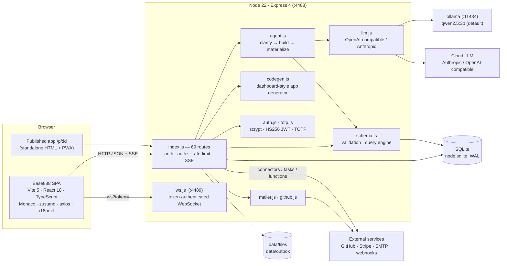
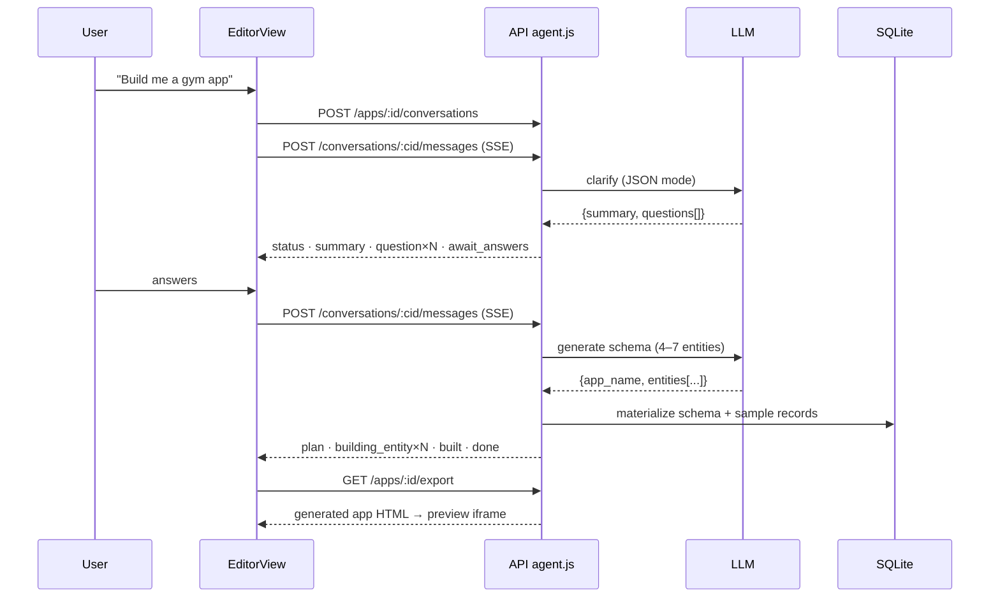

# Base888 — Architecture

Base888 is a clean-room reconstruction of a Base44-style AI app builder: a
React single-page app talks to a Node/Express API backed by SQLite; an agent
turns natural-language prompts into a data model, sample data and a generated
single-file app that can be previewed, edited in Monaco, published and exported.

## 1. System overview



**Ports:** web dev server 5888 · API 4488 · WebSocket 4489 · ollama 11434.
In development Vite proxies `/api`, `/auth`, `/apps`, `/workspaces` to the API.

## 2. Frontend

| Layer | Files | Role |
|-------|-------|------|
| Shell | `components/AppShell.tsx` | Left sidebar with **App / Agent** modes, nav, recent items, upgrade card, workspace footer. Editor and code routes render full-screen outside the shell. |
| Views | `pages/HomePage.tsx` | Greeting + prompt composer + recent / community / templates. Submits → creates an app and opens the editor with the prompt. |
| | `pages/EditorView.tsx` | **Vibe-coding workspace**: build-chat (left), live preview iframe (right), toolbar (branch = checkpoints, preview/dashboard tabs, edit → Monaco, publish). |
| | `pages/SuperagentView.tsx` | Wide agent conversation, channel bar, action chips. |
| | `pages/CodeEditorPage.tsx` | Monaco editor over the generated app's real source + live preview; save feeds publish/export. |
| | `pages/PreviewPage.tsx` | Schema-driven CRUD preview (typed forms, enum selects, reference pickers) + Publish / Export / Snapshot / Dashboard actions. |
| | `pages/AppDashboardPage.tsx` | KPI cards + enum breakdown charts from live data. |
| | `pages/AppEditorPage.tsx` | Entity data editor. |
| | `pages/SettingsPage.tsx` | Credits, model list, TOTP 2FA. |
| | `pages/SimplePages.tsx` | All apps, search, templates, community, connectors, workflows, channels, artifacts, code picker, partners. |
| | `pages/LoginPage.tsx` | Password login + registration. |
| Hooks | `hooks/useAgentChat.ts` | Shared SSE conversation state machine (turns, live render, awaiting answers). |
| | `hooks/useToast.ts`, `useFeatureFlags.ts`, `useDesignSystem.ts`, `useMobile.ts` | UI utilities. |
| API | `api/axiosClient.ts` | Bearer auth, `X-Request-ID`, `X-Active-Workspace-Id`, `X-Active-App-Id`, single-flight refresh on 401. |
| | `api/agentApi.ts` | `createConversation`, `streamMessage` (fetch + ReadableStream SSE parser). |
| | `api/appManageApi.ts`, `builderApi.ts`, `workspaceApi.ts`, `authApi.ts`, `accountApi.ts` | Typed clients. |
| SDK | `sdk/base888Sdk.ts` | `client.auth / entities.<Name> / integrations.core / functions` — Base44-SDK-shaped surface. |
| State | `stores/createStore.ts`, `authStore.ts`, `workspaceStore.ts` | zustand + persisted slices. |
| Context | `context/AuthContext.tsx`, `WorkspaceContext.tsx`, `I18nProvider.tsx` | Session bootstrap, active workspace, i18n. |

Routing (`App.tsx`): `/login` → `LoginPage`; everything else requires auth.
`/apps/:id/editor/preview` and `/apps/:id/code` are full-screen; all other
routes render inside `AppShell`.

## 3. Backend

| Module | Responsibility |
|--------|----------------|
| `index.js` | Express app: security headers, CORS allow-list, request ids, rate-limited auth routes, 69 endpoints, SSE streaming, in-process task scheduler, public `/p/:id` + PWA assets. |
| `src/config.js` | Env-driven config; persists a generated JWT secret on first boot. |
| `src/db.js` | `node:sqlite` schema (17 tables), lightweight `ALTER TABLE` migrations, demo seed. |
| `src/auth.js` | scrypt password hashing, HS256 JWT access tokens (15 min), single-use rotating refresh tokens (30 d, hashed), `requireAuth`, `requireAppAccess` (workspace membership). |
| `src/totp.js` | RFC 6238 TOTP (base32, HMAC-SHA1, ±1 window). |
| `src/schema.js` | Server-side validation (types, required, enum, reference integrity), query engine (`$gt $gte $lt $lte $ne $in $contains`, sort, pagination), schema mutation. |
| `src/agent.js` | Conversation turn orchestration: first turn asks 2–4 clarifying questions; next turn generates a 4–7 entity model (enums, references, sample rows), materializes it, streams step events. |
| `src/builder.js` | One-shot generator + tolerant JSON extraction/repair. |
| `src/llm.js` | Provider abstraction (OpenAI-compatible incl. ollama, or Anthropic) with JSON mode, temperature 0, long-timeout undici dispatcher. |
| `src/codegen.js` | Generates a standalone dashboard-style single-file app (side nav, KPIs, activity, searchable tables) with embedded data. |
| `src/mailer.js` | SMTP via nodemailer, or a real `.eml` written to the outbox. |
| `src/github.js` | Creates a repo and commits files with a user PAT (GitHub REST API). |
| `src/ws.js` | Token-authenticated WebSocket with per-workspace broadcast. |

### Request pipeline

```
request → security headers → CORS → request-id → cookie parser
        → (auth routes) rate limiter 10 / 15 min per IP+email
        → JSON body → route → requireAuth (Bearer JWT) → requireAppAccess (workspace member)
        → handler → JSON / SSE / HTML
```

### Agent flow (SSE)



### Generated app lifecycle

`schema + data` → `codegen` → `app_code` (editable in Monaco) → served by
`/p/:id` (public, PWA), `/export` (download), `/github/export` (commit), and the
editor preview. Checkpoints snapshot schema + data and act as branches.

## 4. Security model

- Passwords: scrypt + per-user salt, constant-time compare.
- Tokens: HS256 JWT (secret persisted with mode 0600), refresh tokens hashed and single-use.
- Authorization: every app-scoped route verifies workspace membership (IDOR → 403).
- Optional TOTP 2FA enforced at login.
- Parameterized SQL everywhere; input validation against the app schema.
- Rate limiting on login/register; security headers; CORS allow-list with credentials.
- Credits (simulated) gate generation; Stripe/GitHub/LLM keys are env-gated and never fabricated.

See `base888/SECURITY-FINDINGS.md` for the audited findings and open items.
