# Base888 — UI Screens

All screenshots are of the current light-theme build (1440×900). Base888 uses its
own mark and name; the layouts follow a Base44-style builder UX.

## 1. Home — `/`

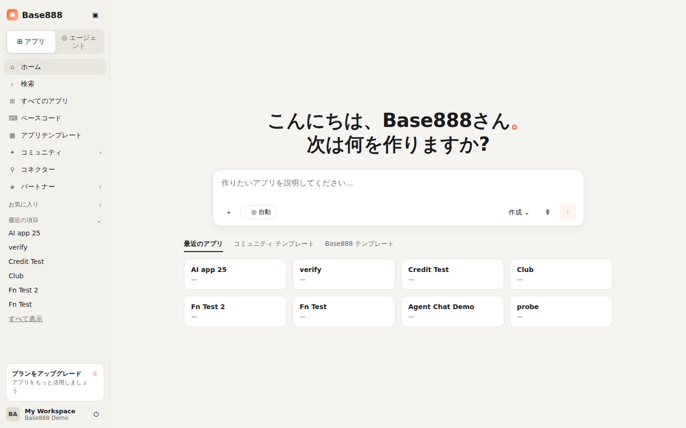

- **Sidebar**: App / Agent mode toggle; nav ホーム・検索・すべてのアプリ・ベースコード・
  アプリテンプレート・コミュニティ・コネクター・パートナー; お気に入り; 最近の項目 (recent
  apps); upgrade card; workspace + user footer with sign-out; collapsible.
- **Greeting**: "こんにちは、{name}さん。次は何を作りますか?" (name from the account).
- **Composer**: multi-line prompt, ＋ attach (placeholder), 自動 mode chip, 作成 menu,
  voice (placeholder), send (Ctrl/⌘+Enter). Submitting creates an app and opens the
  editor with the prompt pre-sent to the agent.
- **Tabs**: 最近のアプリ (your apps) · コミュニティ テンプレート (published apps) ·
  Base888 テンプレート (starter prompts that fill the composer).

## 2. Editor / Preview workspace — `/apps/:id/editor/preview`

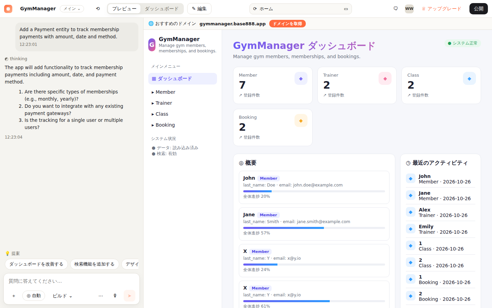

- **Toolbar**: app name + branch chip (メイン ⌄ → list of checkpoints, 新しいブランチを作成),
  history, プレビュー / ダッシュボード tabs, ✎ 編集 (opens Monaco), URL bar, comments,
  avatar, アップグレード, **公開** (publishes to `/p/:id`).
- **Build chat (left)**: user turns, agent steps (thinking → summary → clarifying
  questions → plan → "X を更新しました" per entity → "アプリを更新しました"), timestamps,
  💡 提案 suggestion chips, composer "何を変更しますか?" with ＋ / 自動·手動 / ビルド / ⋯ / voice / send.
- **Live preview (right)**: domain bar (suggested `<app>.base888.app`, ドメインを取得 is a
  UI affordance), iframe of the generated app; refreshes after every build.
- **Dashboard tab**: KPI cards + enum charts inline.

## 3. Superagent — `/superagent/new`, `/superagent/app/:id`

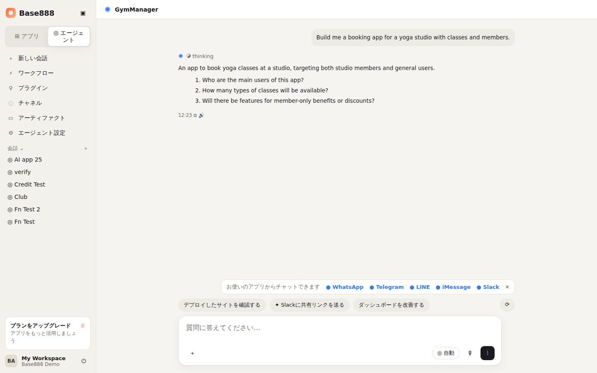

- **Agent sidebar**: 新しい会話・ワークフロー・プラグイン・チャネル・アーティファクト・
  エージェント設定, 会話 list.
- **Conversation**: wide layout, agent summary + clarifying questions + implemented
  entity list, timestamps with copy / read-aloud glyphs.
- **Channel bar**: WhatsApp · Telegram · LINE · iMessage · Slack — displayed, and
  honestly reported as *not connected* when clicked.
- **Action chips**: デプロイしたサイトを確認する (publishes + opens), Slackに共有リンクを送る
  (not connected), ダッシュボードを改善する (fills the composer).
- **Composer**: ＋ / 自動 / voice / send.

## 4. Code editor (Monaco) — `/apps/:id/code`

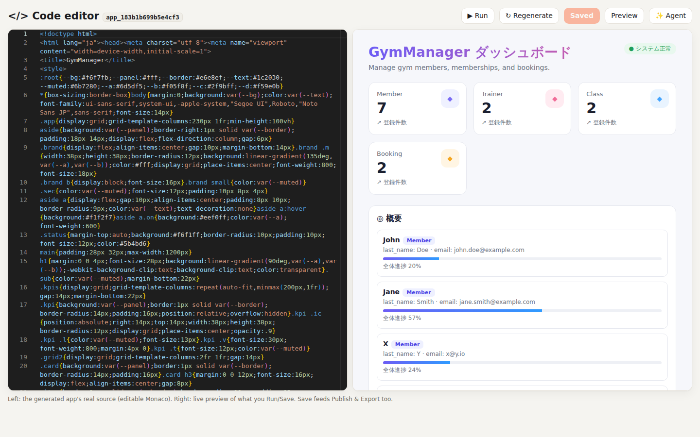

- Left: the generated app's **real source** (single-file HTML/JS) in Monaco
  (HTML mode, dark). Right: live preview of what you Run / Save.
- ▶ Run (preview unsaved code), ↻ Regenerate (from schema + data), Save (feeds
  Publish and Export), links to Preview and Agent.

## 5. Preview (schema-driven CRUD) — `/apps/:id/preview`

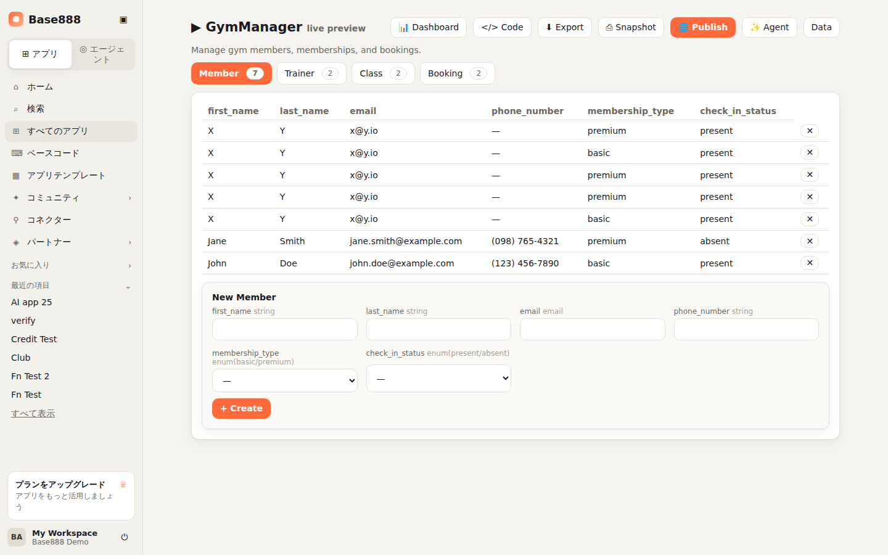

- Entity tabs with record counts; table of records; delete per row.
- "New <Entity>" form with inputs typed by field: text / email / url / number /
  date / datetime / textarea / checkbox / **enum select** / **reference picker**.
- Actions: 📊 Dashboard, `</>` Code, ⬇ Export (standalone HTML), ⎙ Snapshot (checkpoint),
  🌐 Publish (shows the public URL), ✨ Agent, Data.

## 6. Dashboard — `/apps/:id/dashboard`

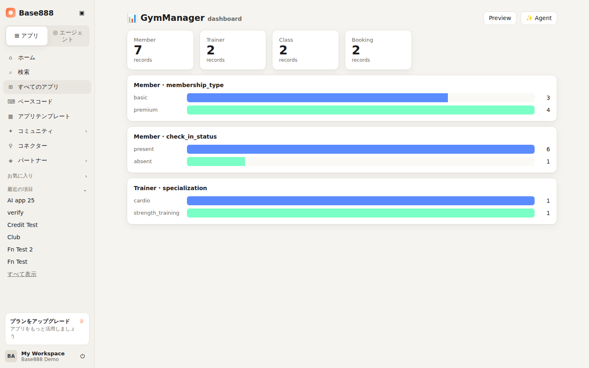

- KPI card per entity (record count).
- One bar chart per enum field with per-value counts, computed from live data.

## 7. Data editor — `/apps/:id/data`

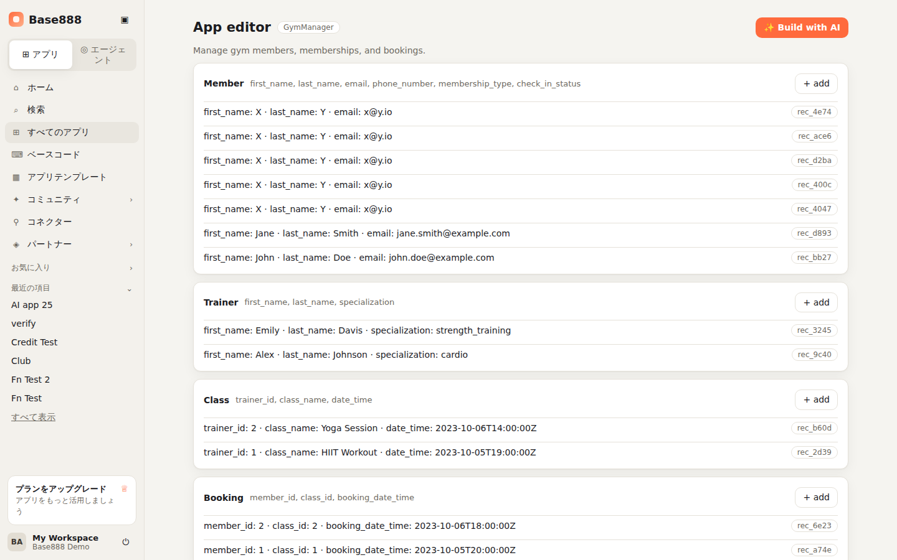

- Entity cards listing records with a `+ add` quick-create; live InvokeLLM demo.

## 8. All apps · Search · Templates · Community

| | |
|---|---|
| 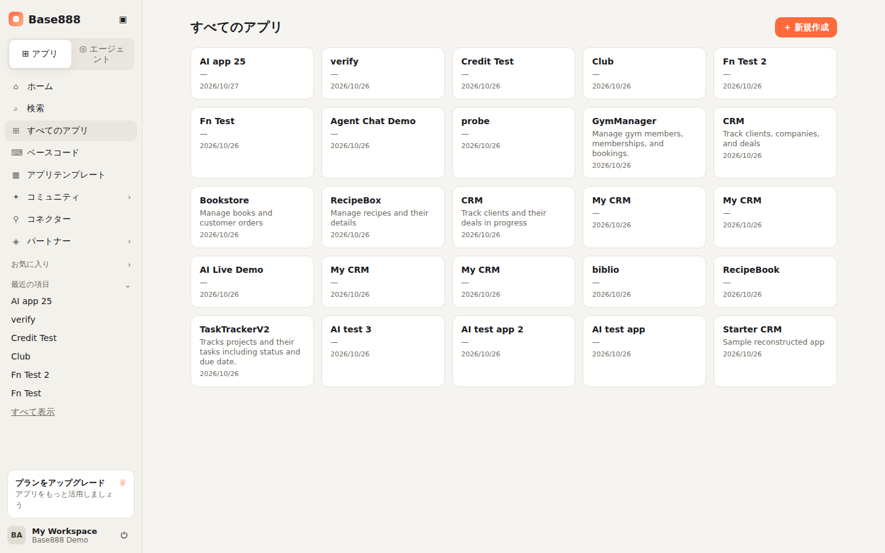 | 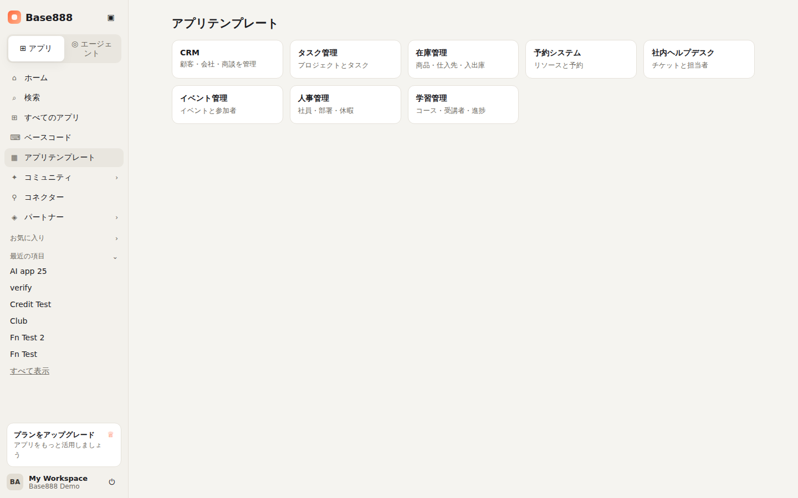 |
| 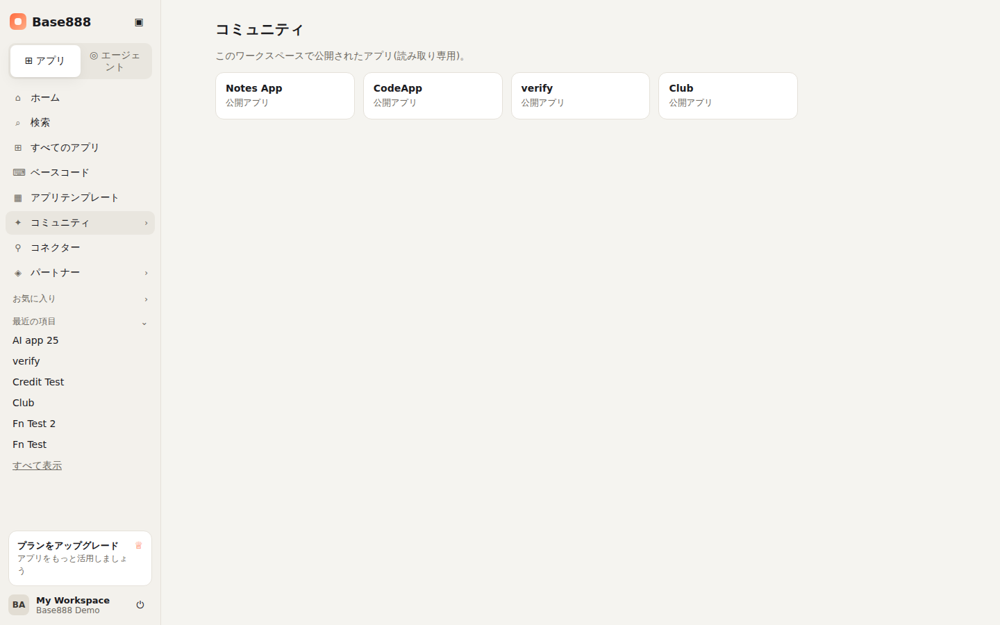 | 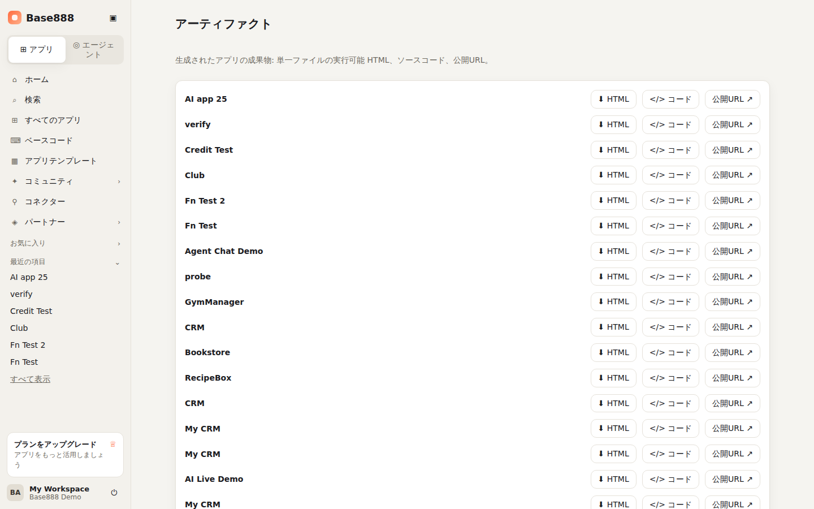 |

- **All apps** `/apps`: tiles → editor; 新規作成.
- **Search** `/search`: live filter by name/description.
- **Templates** `/templates`: one click creates an app and starts the agent with the template prompt.
- **Community** `/community`: apps published with visibility `public`; opens `/p/:id`.
- **Artifacts** `/artifacts`: per app — download standalone HTML, open code, open public URL.

## 9. Connectors · Workflows

| | |
|---|---|
| 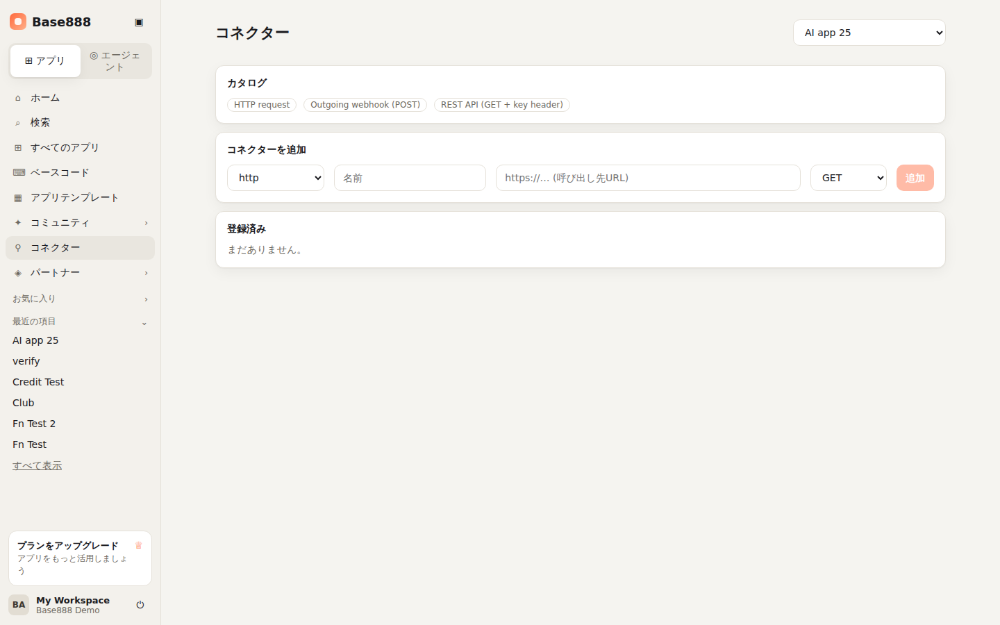 | 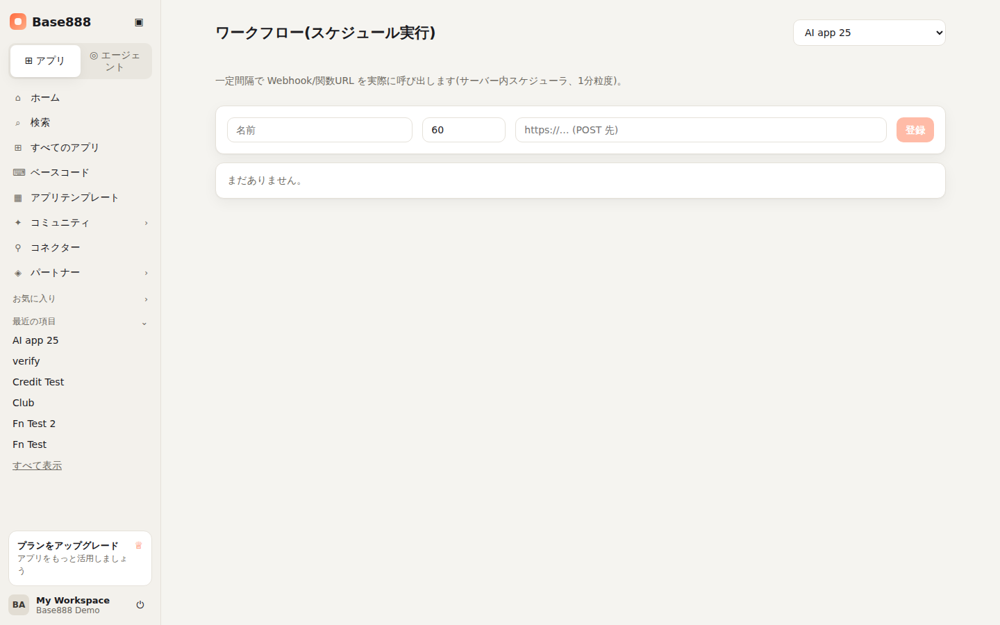 |

- **Connectors** `/connectors`: catalog (http / webhook / rest_api), register a connector
  (name, URL, method), ▶ 実行 performs a real outbound request and shows status + body.
- **Workflows** `/workflows`: register interval tasks (name, every N minutes, POST URL);
  the in-process scheduler fires them and records `last run`.
- **Channels** `/channels`: WhatsApp / Telegram / LINE / iMessage / Slack cards marked 未接続
  with the credential each needs.

## 10. Settings — `/settings`

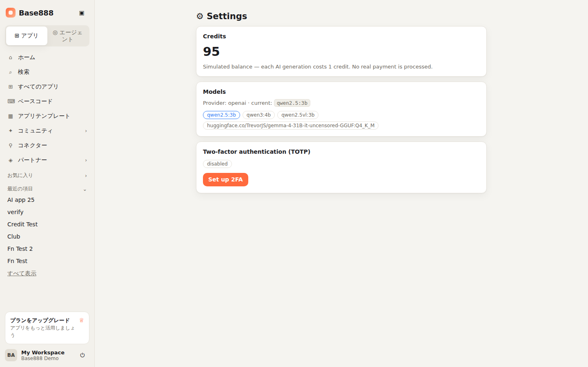

- **Credits**: simulated balance (1 per generation; no real payment).
- **Models**: provider + current model, list of available models from the provider.
- **Two-factor authentication**: set up (secret + otpauth URL) → enter code → enable;
  disable with a code. Login then requires `mfa_code`.

## 11. Login — `/login`

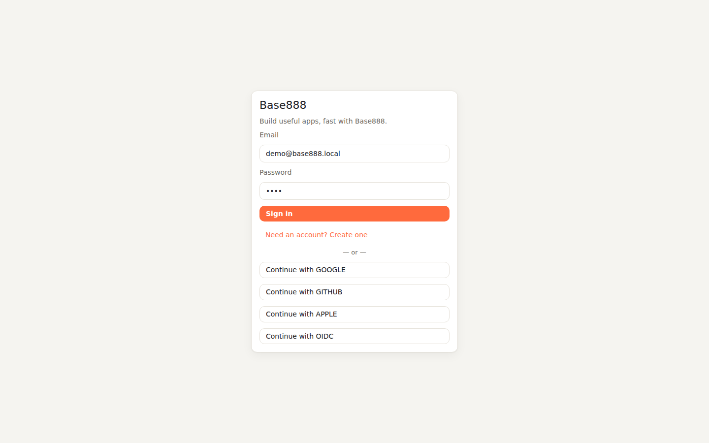

- Email + password sign-in, "Create one" toggles registration (name field).
- Provider buttons (Google / GitHub / Apple / OIDC) are present; the backend
  returns `501 oauth_not_configured` until provider credentials are set.
